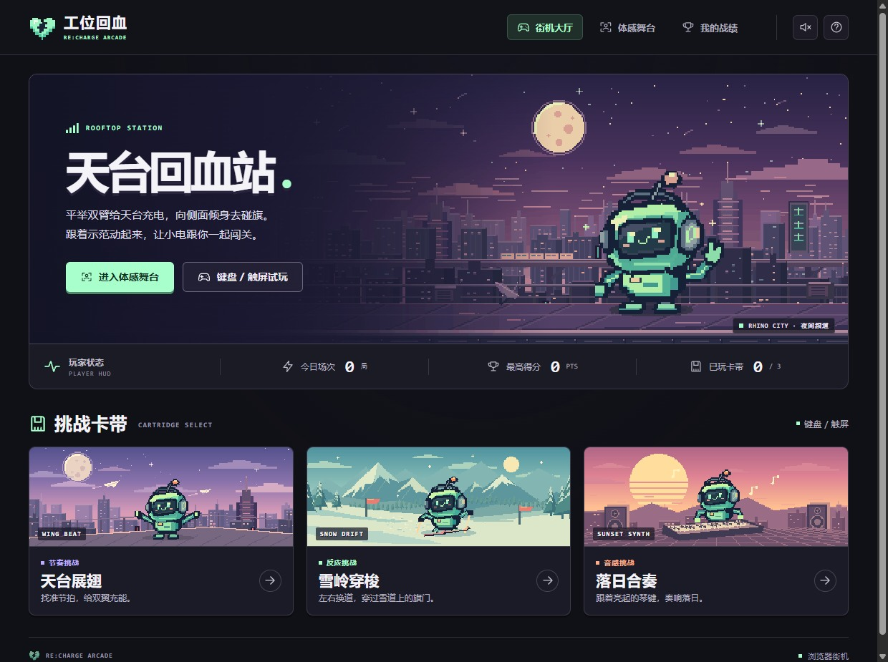
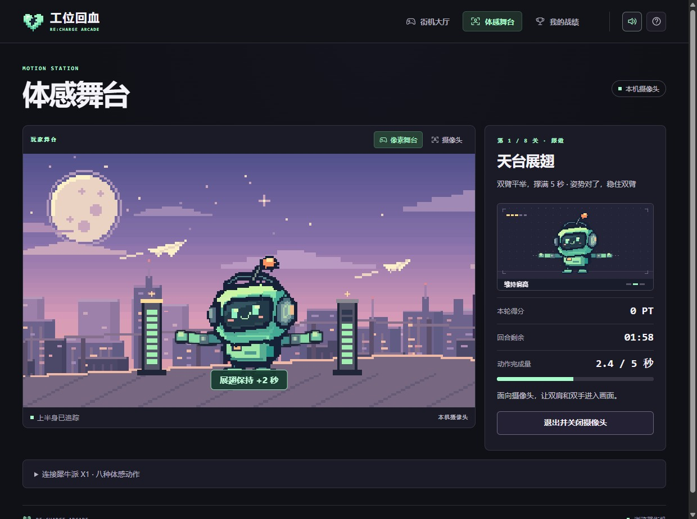

# 工位回血

坐太久了就对着镜头动两下。只要 **上半身**（头、肩、手），C920 工位视野就够。



在电脑上通过 localhost 或 HTTPS 打开大厅，可以用摄像头单练任一关，也可以连续挑战展翅、老鹰、挥手、滑雪、弹琴、跳跃、转头和点头。每关先演示要做的动作，再用摄像头识别并计分。直接打开本机 HTML 时，八款游戏也支持键盘和触屏。[街机大厅](../examples/06_shadow_puppet/web/index.html) · [启动说明](../examples/06_shadow_puppet/README.md)

犀牛派在板端运行八种体感动作。打开 8090 端口的首页，小电随肩、肘、腕和头部动作同步。舞台上方可切换摄像头叠图，回合结束可保存战绩海报。



姿态用板上 AidLite 上半身 BlazePose，弹琴那一屏加载手部 21 点。游戏检测是否在位、是否静坐，并估算坐姿。默认静坐 **25 分钟** 或能量提前耗尽会弹提醒，结束一轮挑战后本段久坐清零。

## 对外怎么说

> 面对工位摄像头举起双手，天台上的小电也会举手，带你开始一轮两分钟的活动挑战。

## 摄像头视图

| 阶段 | 画面 |
| --- | --- |
| 久坐监测 / 提醒 / 离开 | 摄像头实时画面 + 像素 overlay，右侧坐姿评分 |
| 挑战回合 / 总结 | 上半屏是小电的像素舞台，下半屏显示摄像头小窗、回合倒计时和坐姿 |

小电使用和片头相同的角色图。姿态关键点驱动它抬手、倾身、转头和点头。

## 一回合怎么走

1. 默认静坐满 25 分钟会弹「该起来活动了」。展翅或举手也能提前开始。
2. **每组 2 分钟**，默认 6 个动作。每个动作一屏，有自己的 challenge。
3. **过了 challenge 才算过关**，然后自动跳下一屏。2 分钟用完，剩下的记没过。
4. 最后出总结：每个动作的评级、用时、得分，加这一回合的坐姿评分和今日累计。
5. 回到久坐监测。久坐已清零。

| 动作 | challenge |
| --- | --- |
| 展翅 | 双臂撑满 5 秒 |
| 老鹰 | 双臂向两侧展开，一起抬高再压低，扇翅 8 次 |
| 挥手 | 抬起一只手到肩高，左右交替挥，送走 10 个人 |
| 滑雪 | 面朝前，上身向旗子那侧偏，碰到 6 面旗并避开树 |
| 弹琴 | 张开双手，下压黄键对应的手指再抬起，共命中 8 键。手部模型加载失败时用手腕选键、下压 |
| 跳跃 | 坐着轻挺上身起跳、落回坐姿，越过 5 个仙人掌 |
| 转头 | 每次转完回正，向屏幕左右各转 3 次 |
| 点头 | 稳住双肩，低头再抬回 6 次 |

## 坐姿检测

四项扣分：**低头前伸**、**整个人往下塌**、**歪肩**、**离屏太近**。评分 0–100，掉到 60 以下开始催。回合结束会按当时的坐姿重新标定基线。

## 在板子上跑

```bash
cd ~/rhinopi-lab/examples/06_shadow_puppet
python3 game.py
python3 game.py --demo                 # 45 秒就催，录像用
python3 game.py --interval-min 15 --round-acts 6
python3 render_probe.py --out /tmp/ui   # 不用人也能把每一屏渲染出来核对排版
```

```text
http://192.168.88.216:8090/
http://192.168.88.216:8090/status
```

底栏：`FPS`、`POSE ms`、`NPU ms`（QNN236 DSP 脉冲）、NSP/CPU 温度。

## 本机说明

- 上半身模型：`pose_landmark_upper_body.tflite`（31 点）
- 手部：`palm_detection.tflite` + `hand_landmark.tflite`，只在弹琴那一屏加载
- 弹琴时 pose 降到 1/3 帧率，手部每帧跑，保住帧率
- 实测：久坐页约 13 fps；检出姿态后 POSE 约 90–105 ms

拍宣传片（机位、口播、空位、70 秒 / 28 秒剪法）看 [拍摄与剪辑](06-promo-video.md)。录像用 `python3 game.py --demo`。
